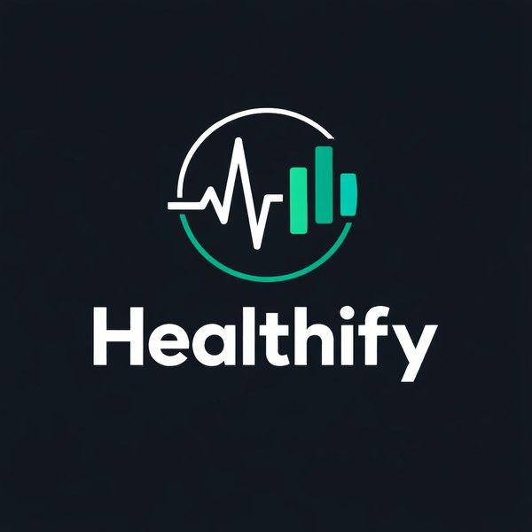
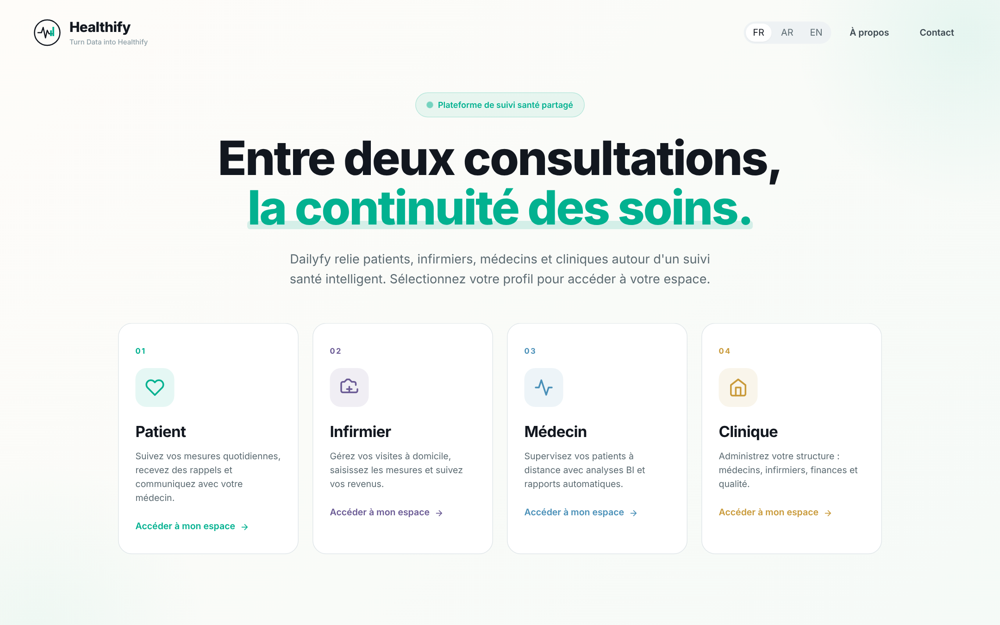
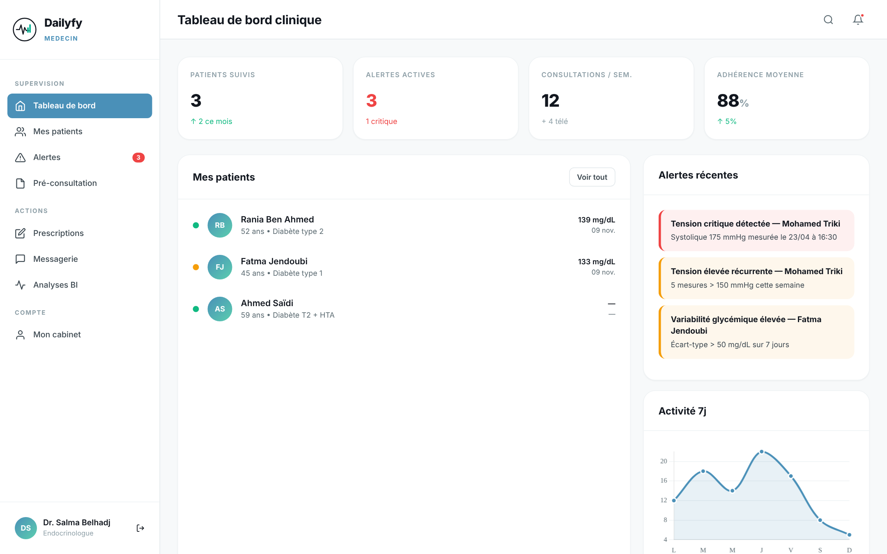
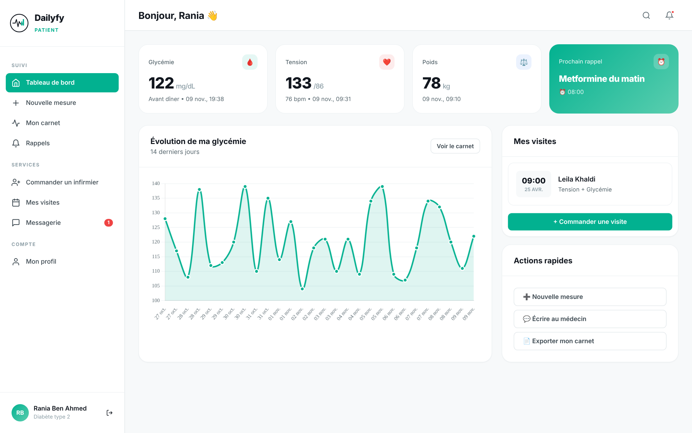
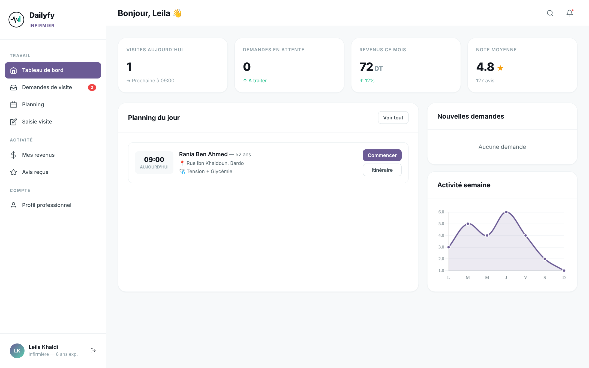
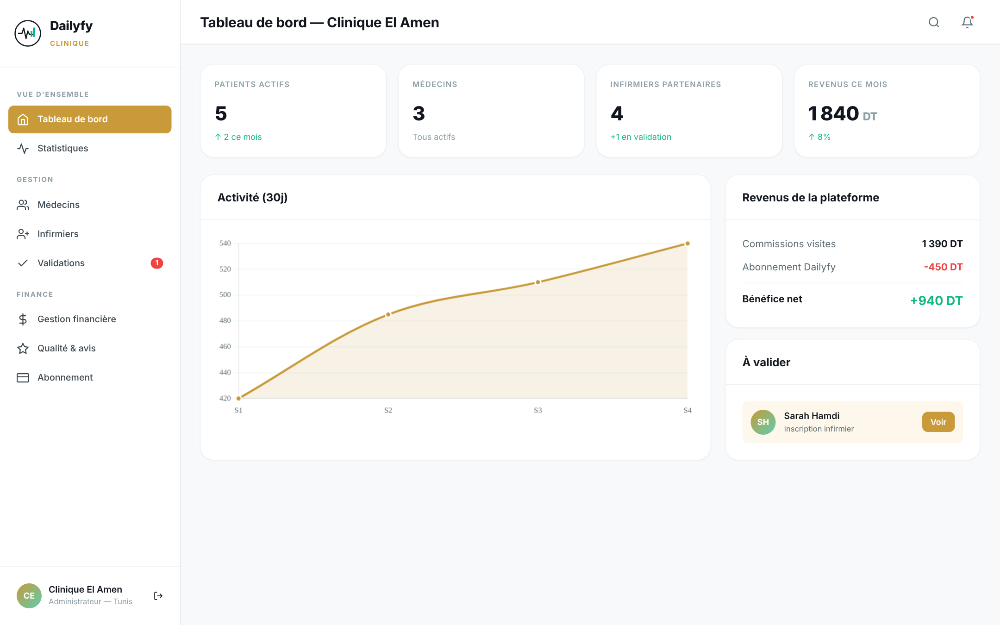
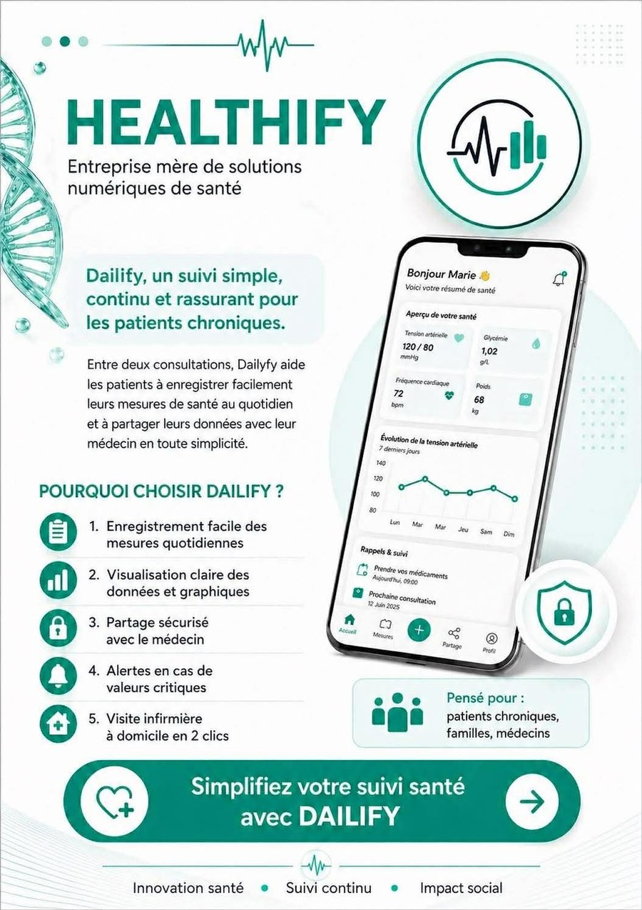
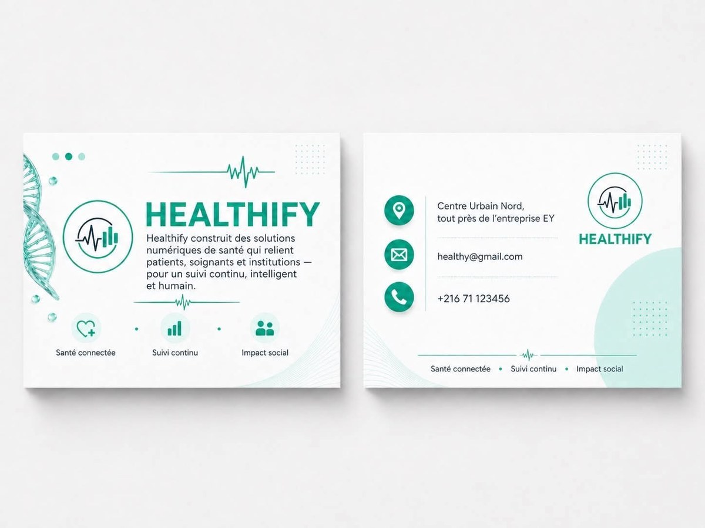
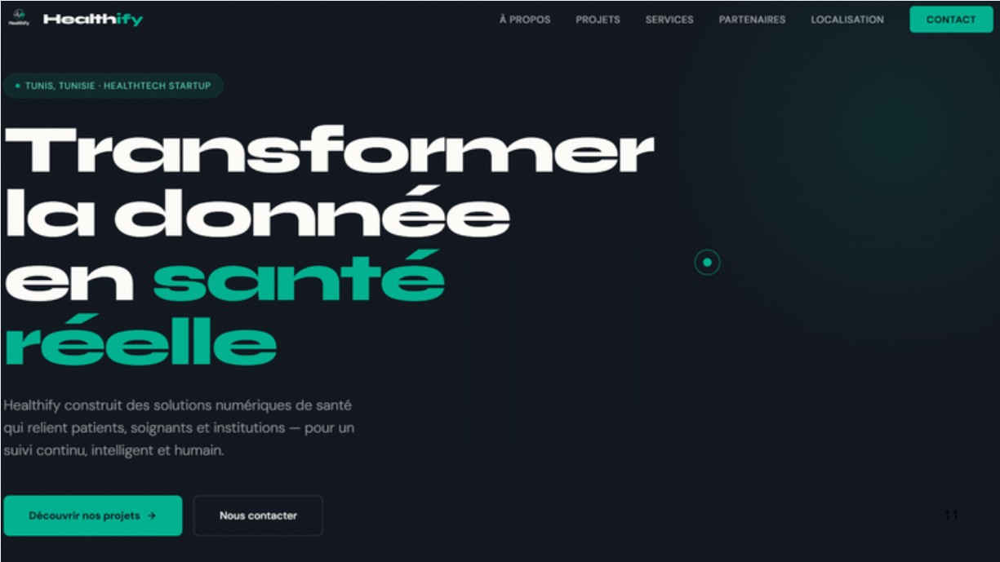
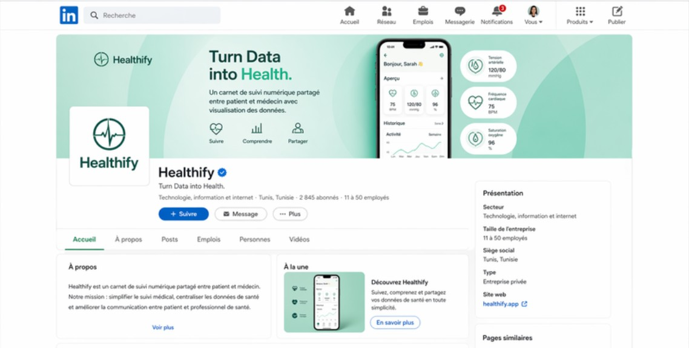

  

<h1 align="center">Dailyfy by Healthify – Plateforme de suivi santé partagé</h1>

  <b>Prix du meilleur projet – Business Intelligence & Entrepreneurship Days, IHEC Carthage</b>

  
  
  
  

  

---

## Le problème
Entre deux consultations, les patients atteints de maladies chroniques (diabète, hypertension) suivent leurs mesures seuls, souvent sur papier. Le médecin ne voit ces données qu'au rendez-vous suivant : c'est une rupture dans la continuité des soins.

## La solution
**Dailyfy** relie quatre acteurs autour d'un suivi santé partagé :

| Acteur | Ce qu'il fait sur la plateforme |
|---|---|
| **Patient** | Saisit ses mesures (glycémie, tension, poids), consulte son carnet sous forme de courbes, reçoit des rappels et commande un infirmier à domicile |
| **Infirmier** | Gère ses visites à domicile, saisit des mesures validées professionnellement et suit ses revenus |
| **Médecin** | Supervise ses patients à distance grâce à un tableau de bord clinique, des alertes et des analyses |
| **Clinique** | Administre les médecins et infirmiers, les finances et la qualité du service |

Le projet a remporté le **prix du meilleur projet**, décerné par un jury d'experts lors des Business Intelligence & Entrepreneurship Days de l'IHEC Carthage.

## Mon rôle
Dans l'équipe, j'ai pris en charge :
- **le prototype web interactif** (`index.html`) : les 4 espaces (patient, infirmier, médecin, clinique), la navigation et les tableaux de bord avec Chart.js ;
- **le cahier des charges** (`Dailyfy_Utilisateurs_Fonctionnalites.pdf`) : la définition des 4 acteurs et la spécification détaillée de leurs fonctionnalités.

---

## Aperçu du prototype

### Espace médecin : tableau de bord clinique

### Espace patient

<table>
<tr>
<th>Espace infirmier</th>
<th>Espace clinique</th>
</tr>
<tr>
<td valign="top"></td>
<td valign="top"></td>
</tr>
</table>

---

## Maquettes et identité visuelle

Les écrans ont d'abord été conçus sur **Figma** :
[voir les maquettes Figma](https://www.figma.com/design/Lep5DPSf92YZHOJnyHnFKU/Untitled?node-id=0-1)

Le projet a aussi été présenté comme une start-up, avec une identité visuelle complète : logo, flyer, cartes de visite, maquette de site vitrine et de page LinkedIn.

<table>
<tr>
<th>Flyer de présentation</th>
<th>Cartes de visite</th>
</tr>
<tr>
<td valign="top"></td>
<td valign="top"></td>
</tr>
</table>

### Maquettes de communication digitale
Maquettes réalisées pour présenter la start-up (ce ne sont pas de vrais comptes en ligne) :

<table>
<tr>
<th>Site vitrine Healthify</th>
<th>Page LinkedIn de l'entreprise</th>
</tr>
<tr>
<td valign="top"></td>
<td valign="top"></td>
</tr>
</table>

---

## Contenu du dépôt

| Fichier | Rôle |
|---|---|
| `index.html` | Prototype interactif de la plateforme (les 4 espaces, données de démonstration) |
| `Dailyfy_Utilisateurs_Fonctionnalites.pdf` | Spécifications détaillées des utilisateurs et des fonctionnalités |
| `images/` | Captures d'écran du prototype |

Le prototype fonctionne directement dans le navigateur : il suffit d'ouvrir `index.html`. Les données affichées sont fictives.

---

## Technologies
- HTML, CSS, JavaScript
- Chart.js (graphiques et tableaux de bord)
- Figma (maquettes)

---

  <i>Projet réalisé en équipe dans le cadre de l'IHEC Carthage (portfolio).</i>

